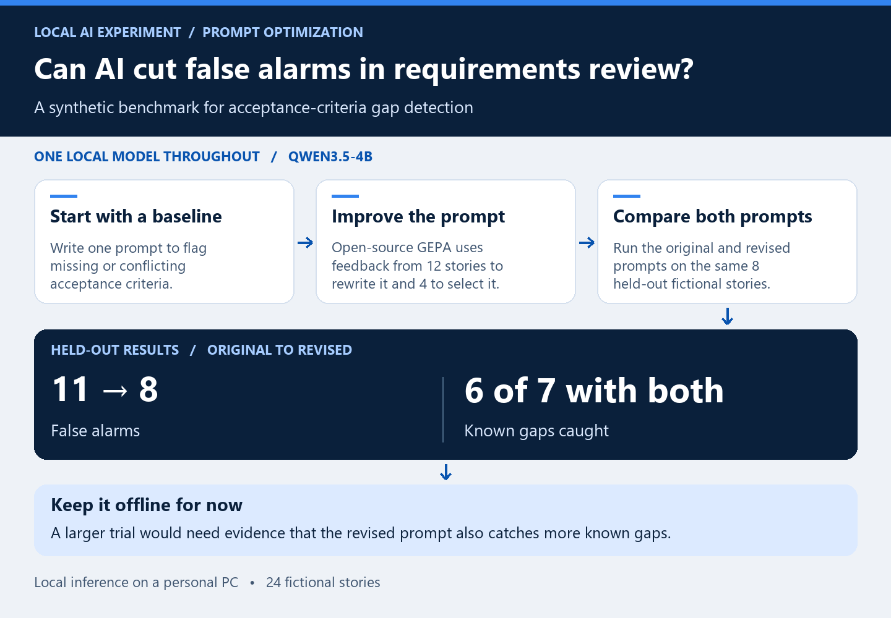

# Can GEPA improve an AI requirements review?

This experiment tests whether an open-source prompt optimizer can make a small language model better at spotting missing or conflicting acceptance criteria. The benchmark uses 24 entirely fictional stories and runs inference locally.

**Result:** On eight held-out stories, GEPA reduced false alarms from **11 to 8**. Both prompts caught **6 of 7 known gaps** and got the complete answer right on **3 of 8 stories**. The revised prompt improved precision on this sample. It fell short of the predefined requirement to catch at least one additional gap.



## What the reviewer does

The model reads a fictional story, its policy, and the written acceptance criteria. It returns a list of gap categories such as missing authorization, an unspecified cutoff, or an omitted state change. For example, a policy might say requests are accepted through day 7, while the acceptance criteria only say “within the grace period.” The expected finding is a missing boundary.

[GEPA](https://github.com/gepa-ai/gepa) uses examples and feedback to propose revised instructions. [DSPy](https://github.com/stanfordnlp/dspy) runs the review and connects it to GEPA. The same local Qwen3.5-4B model reviewed the stories and drafted revisions. The experiment changes the prompt text while keeping model weights, inputs and output schema fixed.

## How the comparison worked

| Split | Stories | Role |
| --- | ---: | --- |
| Training | 12 | Show GEPA where a prompt misses gaps or raises false alarms. |
| Validation | 4 | Select a revised prompt using mean per-story F1. |
| Held-out test | 8 | Compare the original and selected prompts after selection. |

1. Score the original prompt on four validation stories.
2. Pick a parent prompt and run it on three training stories. Compare the predictions with the answer key and generate written feedback.
3. Ask the model to propose revised instructions. Compare the revision with its parent on the same batch.
4. Score an improved revision on all four validation stories and update the candidate pool. Repeat until the evaluation budget is reached.
5. Select the best validation prompt and compare it with the original on the eight reserved stories.

GEPA generated six revisions. Four advanced to validation and two tied their parents on their training batches. Candidates 3 and 4 scored 0.625 on validation, up from 0.500 for the original prompt. Candidate 3 reached that score first and was selected. [Detailed run flowchart](assets/gepa-run.png)

## Held-out results

| Measure | Original prompt | GEPA-selected prompt |
| --- | ---: | ---: |
| Known gaps caught | 6 of 7 | 6 of 7 |
| False alarms | 11 | 8 |
| Precision | 35.3% | 42.9% |
| Micro-F1 | 0.500 | 0.571 |
| Exact story-level matches | 3 of 8 | 3 of 8 |
| Format or runtime errors | 0 | 0 |

A false alarm is a category flagged by the model that was absent from the answer key. Micro-F1 pools correct flags, false alarms and missed gaps across stories.

The revised prompt cleared both false alarms on a clean dispatch story. Both prompts still missed a contradiction where the criteria allowed an unallocated shipment and the policy required allocation. The revision also introduced false alarms on two stories that the original prompt had reviewed correctly.

The decision rule was to catch more known gaps, produce no more false alarms, and return valid results on every test story. The revision met the latter two checks. This small, single-author benchmark measures category detection, and leaves reviewer time savings and performance on other tasks open.

## Reproduce locally

This setup was built for **64-bit Windows** with PowerShell, [uv](https://docs.astral.sh/uv/), and a compatible Vulkan GPU driver. The scripts download pinned Python and llama.cpp builds plus a roughly 3 GB Qwen3.5-4B model. Downloads and dependencies are verified against pinned hashes. Inference uses a loopback endpoint and needs no cloud API key.

```powershell
.\setup.ps1
.\setup-local.ps1
.\.venv\Scripts\python.exe -B experiment.py --mode preflight
.\.venv\Scripts\python.exe -B run-local.py --mode smoke
.\.venv\Scripts\python.exe -B run-local.py --mode experiment
```

The measured optimization took 79.5 seconds on an RTX 3060 Ti. It used 62 model requests, plus 16 for the held-out comparison. The 52-evaluation target was checked between iterations, so the final validation pass brought the recorded total to 56. Results can vary with hardware and inference behavior. A completed experiment replaces the result file.

- [Fictional stories and answer keys](fixtures/stories.json)
- [Recorded results and candidate instructions](results/experiment.json)
- [GEPA research paper](https://arxiv.org/abs/2507.19457)
